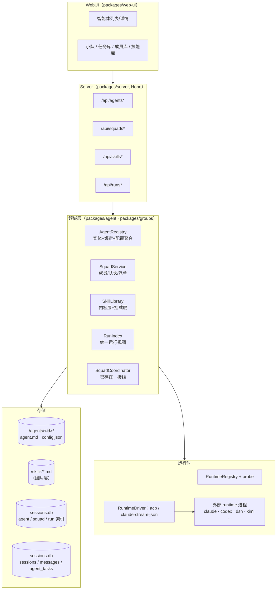

# FengAgentCli AI 团队平台 Spec（智能体 / 小队 / Skill / 任务执行）

> 版本：v1（评审稿）　范围：设计文档，不含实现代码
> 参考源码：`multica-ai/multica`（main）、`sleep2agi/agent-network`（main）
> 对照代码库：`D:\AgentCode\FengAgentCli`（refactor/cordis 分支）
> 目标读者：owner（决策）、后续按阶段接手的 agent（实施）

---

## 0. 结论先行

1. **底座已经有一半以上，缺的是"智能体"这个实体本身。**
   `packages/server/src/agent-runtimes.ts` 已有 runtime 注册 + 探针，`packages/agent/src/runtime-driver.ts` 已有 ACP / claude-stream-json 两种驱动，`packages/server/src/routes/agent-tasks.ts` 已有派单 API 与 7 态任务台账 + SSE，`packages/server/src/skill-service.ts` 已有三层技能库（builtin/team/workdir），`packages/groups` 已有群聊编排，`packages/agent/src/squad.ts` 已有 SquadCoordinator（但**没有接线**）。
   但是：**agent 目前只是 `.fengagent/agents/*.md` 一份 markdown + 一个字符串 id**，没有 CRUD API、没有绑定、没有配置聚合、没有历史索引、没有权限字段。owner 要的四块，本质都是"把 agent 提升成一等公民实体"。

2. **架构选型：文件即真相 + SQLite 索引 + 服务层聚合。**
   - 抄 **agent-network（ANET）** 的"目录即唯一真相"：一个 agent 一个目录，配置可 git、可复制、可手工改；
   - 抄 **Multica** 的"关系表 + 软编排"：小队、成员、挂载关系、运行索引落 SQLite，查询与权限判定走 SQL；
   - **不抄**两者的中心化 server / daemon 双进程模型。FengAgentCli 是本地 CLI + 本地 server，没有多机 daemon 池，抄过来是纯负债。

3. **小队不抄 Multica 的"leader 单点 + @mention 软编排"，但保留其语义；调度抄自己的 SquadCoordinator。**
   Multica 的队长其实是"一个被注入 briefing 的 agent，在评论里 @ 人"，没有真正的子任务 fan-out；它在中心化多人协作场景合理，在本地 CLI 场景（没有 issue 评论流）不成立。FengAgentCli 应做**双模式**：`leader` 模式（队长用 `dispatch_task` 工具派活，语义同 Multica）+ `auto` 模式（SquadCoordinator 按优先级/冷却/转派自动分配，代码已存在）。

4. **skill 复用的正解是"共享库 + 挂载关系"，不是复制。**
   Multica：`skill` 表（workspace 级）+ `agent_skill(agent_id, skill_id, enabled)`；ANET：`~/.anet/skills` 团队目录 + 启动时 symlink 进各 runtime 的 skills 根。FengAgentCli 两者合流：**内容留在 `<dataRoot>/skills/`（团队层，人可读可改），挂载关系落 `agent_skill` 表**。

5. **"每个智能体都能看彼此的运行记录"= 默认共享 + 一条硬隔离边界。**
   Multica 的运行记录按"项目可见性"共享，不是 per-agent 隔离；ANET 的节点令牌读作用域是整个 network。FengAgentCli 同理：同一数据根内 run 记录全可见，**唯一硬边界是 secret（env 明文）与跨数据根/跨项目**。

6. **分四期**：P0 智能体实体化（含运行时绑定 + 概览/历史）→ P1 skill 四路导入与挂载 → P2 小队与队长派单 → P3 团队并行执行、记录治理、MCP/外部集成。

---

## 1. 目标、范围与非目标

### 1.1 owner 原始需求逐条对照

| # | owner 原话 | 本 spec 覆盖 | 阶段 |
|---|---|---|---|
| 1 | 智能体可以绑定运行时 | §5.1.2 | P0 |
| 2 | 每个智能体可以看到概览和运行的历史对话记录 | §5.1.3 / §5.1.4 | P0 |
| 3 | 可以配置指令、skill、mcp、以及集成外部平台 | §5.1.5 | P0（指令）/ P1（skill）/ P3（mcp、集成） |
| 4 | 在设置中可以环境变量、自定义参数、访问权限 | §5.1.6 | P0（env/args）/ P1（权限） |
| 5 | 小队创建团队绑定一些智能体设置队长进行任务完成 | §5.2 | P2 |
| 6 | skills 可以本地导入、url 导入、手动创建、从运行时复制 | §5.3.2 | P1 |
| 7 | 这个导入 skill 可以被其他智能体进行设置添加 | §5.3.3 | P1 |
| 8 | 完成任务可以利用团队或者单个智能体进行任务执行 | §5.4.2 | P0（单）/ P2（团队） |
| 9 | 每个创建的智能体是否可以看到每个智能体执行的相关记录 | §5.4.4 | P3（读侧 P0 就有，治理在 P3） |

### 1.2 非目标（本期明确不做）

- 不做多机分布式调度、不做 daemon 进程池（FengAgentCli 是单机本地工具）。
- 不做 workspace / 多租户模型（没有 Postgres，也没有第二个租户）。
- 不做 issue / 评论 / PR 这类"工作项"体系（那是 Multica 的产品面，不是 CLI 的）。
- 不做 agent 市场、skill 商店的服务端（URL 导入只是拉取，不做审核发布流）。
- 不改动现有 `dispatch_task` / 群聊 / 会话链路的对外契约（只加不改）。

---

## 2. 现有能力盘点（FengAgentCli 基线）

数据根：`resolveDataRoot()` 优先级 `FENG_DATA_DIR` > config `dataDir` > `<workdir>/.fengagent-cordis`（`packages/shared/src/data-root.ts:37-39`，`constants.ts:59`）。下文 `<dataRoot>` 指它。

| 能力 | 现状 | 证据 | 缺口 |
|---|---|---|---|
| Agent 定义 | markdown + frontmatter（`name/description/model/tools/max_turns/small_model`），body = systemPrompt；有内置 `default/coder/researcher` | `packages/agent/src/agent-definition.ts`（`parseAgentMarkdown` / `createAgentDefinitionLoader` / `BUILTIN_AGENTS`）、`<dataRoot>/agents/*.md` | 无 id/版本/CRUD API；无 runtime 绑定字段；无 env/args/权限字段 |
| 运行时注册表 | `RuntimeEntry{name,command,args,protocol,env,permissionPolicy,enabled}` + 探针（握手 → `agentName/agentVersion/capabilities`）+ 错误码 `bad_request/conflict/not_found/unsupported_protocol/command_not_found/spawn_failed/credentials_missing/handshake_failed/probe_timeout` | `packages/server/src/agent-runtimes.ts` | 只有"全局 runtime 列表"，没有 agent ↔ runtime 绑定关系 |
| 运行时驱动 | `RuntimeDriver` 抽象；`acp` 与 `claude-stream-json` 两种协议；支持 `env` / `extraArgs` 注入 | `packages/agent/src/runtime-driver.ts`（`ClientRuntimeDriver` / `createRuntimeDriver`） | 无"绑定失效降级/重绑"语义 |
| 派单 API | `GET/POST /api/runtimes`、`/api/agent-tasks`（建/查/取消/重试/SSE） | `packages/server/src/routes/agent-tasks.ts`、`docs/AGENTS-DISPATCH.md` §3 | 派单对象是 **runtime 名**，不是 agent id |
| 任务台账 | SQLite：7 态 `created/dispatched/running/replied/failed/cancelled/expired` + `agent_task_events(seq,type,detail)` + 幂等键 + attempt | `packages/agent/src/agent-task-store.ts` | 无 `agent_id/squad_id/parent_task_id` 列；无跨 agent 查询 |
| 会话存储 | SQLite：`sessions(id,title,model,status,token_count,…)` + `messages(id,session_id,role,content,created_at)` | `packages/agent/src/session.ts` | `messages` 无 tool_call_id / 无 run 归属；session 无 agent 字段 |
| 群聊编排 | `AgentGroupService`（群/消息/SSE）+ `GroupOrchestrator`（轮次/静默/收敛）；存储可注入（server 用 SQLite，插件用 JSON） | `packages/groups/src/{agent-group-service,group-orchestrator}.ts`、`packages/agent/src/agent-group-store.ts` | 群成员 = runtime，不是 agent 实体 |
| Squad | `SquadCoordinator`：优先级分配、失败计数、冷却、自动转派、永久失败判定 | `packages/agent/src/squad.ts`、`packages/core/src/squad.ts` | **零接线**：没有 API、没有持久化、没有 UI（只在 `index.ts` 导出） |
| Skill 库 | 三层合并 `builtin/team/workdir`，支持 shadow/override、新建/改名锁/启停/重置；`SkillService` + `routes/skills.ts` | `packages/server/src/skill-service.ts`、`routes/skills.ts`、`docs/` | 只有"手动创建"一种写入；无 URL 导入、无从 runtime 复制、无版本、**无 agent 挂载关系** |
| MCP | 只有"群 MCP 服务面"（把群聊暴露给外部 agent，per-member token） | `packages/server/src/mcp-groups.ts`、`mcp-groups-bridge.ts`、`docs/MCP-PERMISSIONS.md` | 无"agent 级 MCP server 配置" |
| 外部平台集成 | 无 | — | 全新 |
| 权限 | 全局 permission rules（面板可配 + 撤销） | `packages/core/src/permission.ts`、`packages/server/src/routes/settings.ts` | 无 agent 级"谁能调起我"的授权 |
| UI | `teams.tsx` 四子视图（团队 / 任务库 / 成员库 / 技能库），`agent-views.tsx`、`skill-views.tsx`、`settings.tsx` | `packages/web-ui/src/pages/` | 无"智能体详情页"（概览 / 历史 / 配置 / 设置） |
| API 面 | 已挂载：`/api/health /sessions /models /runtimes /agent-tasks /groups /groups/mcp /eval /webui /plugins /settings /skills` | `packages/server/src/server.ts` | **没有 `/api/agents`** |

**一句话结论**：`runtime` 有、`任务` 有、`skill 内容层` 有、`群聊` 有、`squad 算法` 有；**`agent` 没有实体层，所以这四块拼不起来**。

---

## 3. 参考实现解剖

### 3.1 Multica：中心化 Postgres + Go server + 多机 daemon

#### 3.1.1 智能体与运行时绑定

| 表 | 关键列 | 说明 / 证据 |
|---|---|---|
| `agent` | `workspace_id, name, runtime_id, runtime_mode('local'\|'cloud'), visibility, permission_mode, status, max_concurrent_tasks, instructions, custom_env, custom_args, mcp_config, model, thinking_level, archived_at` | `runtime_id` 是 **单值 FK**（`004_agent_runtime_loop.up.sql:17-18,70-73`），`ON DELETE RESTRICT`；`251_agent_runtime_unbind.up.sql:52-53` 放开为可空 = "解绑"态 |
| `agent_runtime` | `workspace_id, daemon_id, provider, status('online'\|'offline'), last_seen_at, owner_id, visibility, shared_with, profile_id, max_concurrent_tasks` | 内置唯一键 `(workspace_id,daemon_id,provider) WHERE profile_id IS NULL`（`121_agent_runtime_provider_partial_unique.up.sql:26-28`） |
| `runtime_profile` | `display_name, protocol_family, command_name, fixed_args, visibility, enabled, runtime_type` | provider 白名单从 `120_runtime_profile.up.sql:41-55` 起，历次 migration 扩到 30 种 |

**绑定是 1:N，不是多对多**：一个 agent 恰好绑 1 个 runtime，一个 runtime 承载 N 个 agent，**没有 `agent_runtime_binding` 中间表**。共享靠列而不是表：`agent_runtime.visibility('private'|'public')` + `shared_with uuid[]`（`083_runtime_visibility.up.sql`、`592_runtime_shared_with.up.sql`）。

**解绑语义（很值得抄）**：删 runtime 不再连坐删 agent，而是把 `agent.runtime_id` 与 `agent_task_queue.runtime_id` 置 NULL，并加 `CHECK (runtime_id IS NOT NULL OR completed_at IS NOT NULL)`，保证"活跃任务必有 runtime、历史任务不丢"（`251:14-44`）。

**派单时怎么按 runtime 选**：入队瞬间就把 `runtime_id` 写死（`pkg/db/queries/agent.sql:342-351`），claim 时靠 SQL 围栏 `atq.runtime_id = @runtime_id AND a.runtime_id = atq.runtime_id AND r.status='online' AND last_seen_at >= now()-stale`（`agent.sql:781-831`）——**改绑之后旧 runtime 再也抢不到旧任务**，这是"绑定立即生效"的实现方式。

#### 3.1.2 任务执行与运行记录

- 任务表 `agent_task_queue`，状态枚举 8 种（`128:5-17`）：`queued / dispatched / running / completed / failed / cancelled / waiting_local_directory / deferred`。
- 消息表 `task_message`（`026_task_messages.up.sql:1-13`）：`task_id, seq, type, tool, content, input, output, created_at`；后续加 `output_truncated`（457）、`call_id`（500）。**没有 role/kind 列**，语义由 `type`（`text/tool_use/tool_result/thinking/error`）+ `call_id` 配对承担；写入用 `unnest` 批量 + `ON CONFLICT (id) DO NOTHING` + `ORDER BY seq` 保证重放顺序（`pkg/db/queries/task_message.sql:6-86`）。
- 读侧两条：`GET /api/issues/{id}/task-runs`（运行列表）/ `GET /api/tasks/{id}/messages?since=seq`（增量对话）；前端 `useTaskMessages` 把 WS 帧与 HTTP 回填按 `seq` 合并（`packages/core/chat/queries.ts:201-237`）。
- **互相可见性**：这两条接口只校验 `loadIssueForUser` / `requireTaskVisible`（项目可见性），**不校验"是不是我自己的 run"**（`handler/project_access.go:131-152`）；agent 的 task token 会被盖成 owner 的 `X-User-ID`，所以 agent 可以直接读别的 agent 的 run。唯一硬隔离是 daemon 侧接口是 runtime 绑定的（`daemon.go:205-292`）。

#### 3.1.3 小队（Squad）

- `squad`：`name, description, leader_id NOT NULL REFERENCES agent(id) ON DELETE RESTRICT, creator_id, instructions, archived_at, avatar_url`（`084_squad.up.sql:2-12`、`088_squad_instructions.up.sql`）。
- `squad_member`：`(squad_id, member_type IN ('agent','member'), member_id, role)`，`UNIQUE(squad_id,member_type,member_id)`（`084:17-28`）。`role` 是**自由文本**，不是枚举。
- **队长不是自动拆任务，是"软编排"**：指派给 squad 时只给 leader 建**一条**任务，打 `is_leader_task=true` + `squad_id`（`service/task.go:1503-1530`）；daemon claim 时把 briefing **追加**到 agent instructions（`resp.Agent.Instructions + "\n\n" + briefing`，`handler/daemon.go:3260-3264`）。briefing 三段固定：`Operating Protocol`（只协调不干活、用 `mention://` @ 成员、派完即停）+ `Roster`（每个成员带 type/role/**skill 名列表**）+ `Squad Instructions`（`handler/squad_briefing.go:256-347`）。
- 回写三条：worker 评论唤醒 leader（`handler/comment.go:2842-2905`）、子任务完成 `child_done` 唤醒父 issue 的 squad leader（`service/issue_wakeup_system.go:24-51`）、每轮强制 `POST /api/issues/{id}/squad-evaluated` 写 `activity_log` 留痕（`handler/squad.go:1021-1183`）。

#### 3.1.4 Skill 导入与共享

- 表：`skill(id, workspace_id, name, description, content, config, …)` + `skill_file(skill_id, path, content)` + `agent_skill(agent_id, skill_id, enabled)`（`008_structured_skills.up.sql:4-33`）；`skill_version` 追加式全量快照（`612_skill_version.up.sql:16-30`）。
- **四种导入**（这是 owner 需求的直接原型）：

| 方式 | 入口 | 落点 |
|---|---|---|
| 手动创建 | `POST /api/skills` | `skill` + `skill_file` |
| URL 导入 | `POST /api/skills/import`（JSON `{url,on_conflict}`） | 探源 `detectImportSource` → `fetchFromClawHub/fetchFromSkillsSh/fetchFromGitHub` → `finishSkillImport`；来源存 `skill.config.origin={type,source_url,…}` |
| 本地文件导入 | `POST /api/skills/import`（multipart，`.skill`/`.zip` ≤16 MiB） | `importSkillFromArchive` |
| 从运行时复制 | `POST /api/runtimes/{id}/local-skills/import` + daemon 回传结果 | `config.origin={type:"runtime_local", runtime_id, provider, source_path}` |

  冲突策略 `on_conflict ∈ fail|overwrite|rename|skip`。
- **复用**：workspace 级共享库 + `agent_skill` 关联。`PUT /api/agents/{id}/skills`（全量替换）、`POST .../skills/add`（增量 `ON CONFLICT DO NOTHING`）、`PUT .../skills/{skillId}/enabled`、`DELETE .../skills/{skillId}`；执行时只取 `enabled=TRUE`。
- **生效路径**：claim 时发"瘦 refs"（`{id,source,hash}`）→ daemon `skill-bundles/resolve` 回源 → 缓存校验 hash → 写盘到 `{workDir}/.claude/skills/<slug>/SKILL.md`（codex/hermes 各有自己的根）。`agent.disabled_runtime_skills JSONB` 用来**屏蔽 runtime 磁盘自带的同名 skill**（Claude 侧用 `skillOverrides=off` + `permissions.deny`）。

### 3.2 agent-network（ANET）：中心化 Hub + 节点目录

- **目录即真相**：一个 agent 一个 `.anet/nodes/<alias>/`（`config.json` / `.env` / `logs/` / `goals.json`），Hub 只是注册表，删目录即下线。`config.json` 字段含 `runtime / model / flags / env / tools / session / systemPrompt / role / permissionMode`。
- **runtime 归一化**：`RUNTIME_MAP` 把历史名收敛到 5 个桶，`claude-code-cli` 故意不入表（直接 spawn 本机 `claude`）——把"特例"写在代码注释里而不是散在分支里。
- **可用性做证据**：四问探测（CLI 能否解析 / 登录文件或 key **变量名**是否存在 / provider HEAD 5s / 共享登录数），结果五态 `ready|missing_cli|not_logged_in|no_network|unknown`，每 runtime 20s 截止，后台跑、心跳只读缓存（`agent-node/src/runtime/runtime-readiness.ts:1-53`）。
- **团队**：`network_agent_teams(network_id, team_id, name, parent_id, lead_node_id, owner_user_id)` + 成员表（一个节点最多一个团队）——**队长就是一个 `lead_node_id` 字段**，没有 briefing 注入，也**没有按团队派活/自动挑人**（只支持 `send_task(alias,…)`）。
- **skill**：节点磁盘 `<name>/SKILL.md`（名字白名单 `[A-Za-z0-9._-]{1,64}`、单文件 ≤256 KiB、`description` 取 frontmatter）；团队目录 `~/.anet/skills/<name>`，节点启动时 `installTeamSkills` **软链**进各 runtime 的 skills 根（Windows 退化 junction → 退化复制 + marker），同名非本方创建的一律不覆盖并告警。
- **记录可见性**：节点令牌的读作用域 = 整张 network（`server/src/tools.ts:357,765-776`），`list_tasks` 不加"只看发给自己的"收窄；只有**人类受限成员**才按授权范围展开。

### 3.3 两者取舍 → 对 FengAgentCli 的结论

| 维度 | Multica | ANET | FengAgentCli 取谁 |
|---|---|---|---|
| 状态权威 | Postgres（服务端唯一真相） | 磁盘目录（节点唯一真相），Hub 存注册表 | **磁盘为主 + SQLite 索引**（ANET 内核 + Multica 查询能力） |
| agent↔runtime | 1:N 单列 FK，claim 围栏保证立即生效 | config 里一个 `runtime` 字符串 | **Multica 的 1:N + 围栏语义**（简单、够用） |
| 队长 | `leader_id` FK + briefing 注入 + @mention 派单 | `lead_node_id` 字段，无派单协议 | **两者合并**：字段抄 ANET，briefing/派单协议抄 Multica，另加本地自动调度模式 |
| skill 复用 | 共享库 + `agent_skill(enabled)` | 团队目录 + symlink | **Multica 的挂载表 + ANET 的文件约定** |
| skill 导入 | 四路 + 冲突策略 + 版本快照 | URL catalog + sha256 校验 | **Multica 四路 + ANET 的 sha256/名字白名单** |
| 记录可见性 | 项目可见性共享，daemon 侧 runtime 隔离 | 整 network 共享，人类受限才收窄 | **同数据根共享 + secret 硬隔离** |
| 落地成本 | 高（Go server + PG + daemon） | 中（Hub + 节点进程） | **低（扩展现有 Hono + bun:sqlite）** |

---

## 4. 目标架构

### 4.1 分层



### 4.2 文件布局（新增部分用 `+` 标注）

```
<dataRoot>/
  config.json
  + secrets.env                 # 全局 env 兜底（0600，不进 git）
  agents/
    coder.md                    # 兼容旧格式（迁移期直接可读）
  + agents/coder/
  +   agent.md                  # frontmatter 扩展 + body=instructions
  +   config.json               # 运行时绑定 / 模型 / 参数 / env 引用 / 权限
  +   skills.json               # 挂载的 skill 名 + enabled + 覆盖参数
  +   mcp.json                  # 挂载的 mcp server 引用 + enabled
  +   integrations.json         # 外部平台集成引用
  skills/                       # 既有团队层，内容仍落这里
    code-review.md
  + skill-sources.json          # 导入来源台账（url/sha256/导入时间），与 SQLite 双写
  sessions.db                   # 既有；新增下列表
  logs/
```

**为什么内容留文件、关系进库**：`SkillService` 现在的读写全基于文件（三层 shadow/override 逻辑很干净，`skill-service.ts`），把它改成 DB 驱动是纯风险。反过来，"谁挂了哪个 skill"是典型关系数据，用文件表达会出现改一处漏一处。

### 4.3 数据模型

新增表（都进现有 `sessions.db`，与 `sessions/messages/agent_tasks` 同库，免跨库事务）：

```sql
-- 智能体实体（agent.md 的索引 + 关系字段；内容以文件为准，这里存可查字段）
CREATE TABLE IF NOT EXISTS agent (
  id            TEXT PRIMARY KEY,          -- 目录名，稳定标识，创建后不可改
  name          TEXT NOT NULL,             -- 展示名
  description   TEXT NOT NULL DEFAULT '',
  runtime_name  TEXT,                      -- 绑定的 runtime 注册名；NULL = 未绑定
  runtime_fallbacks TEXT NOT NULL DEFAULT '[]',  -- 降级候选（JSON 数组）
  model         TEXT,
  visibility    TEXT NOT NULL DEFAULT 'private', -- private | workspace
  permission_mode TEXT NOT NULL DEFAULT 'inherit', -- inherit | ask | allow | deny
  kind          TEXT NOT NULL DEFAULT 'user',    -- user | builtin
  archived_at   INTEGER,
  created_at    INTEGER NOT NULL,
  updated_at    INTEGER NOT NULL
);
CREATE UNIQUE INDEX IF NOT EXISTS idx_agent_name ON agent(name) WHERE archived_at IS NULL;

-- skill 挂载（agent 复用团队库的唯一入口）
CREATE TABLE IF NOT EXISTS agent_skill (
  agent_id   TEXT NOT NULL,
  skill_name TEXT NOT NULL,               -- 指向 <dataRoot>/skills/<name>.md
  source     TEXT NOT NULL DEFAULT 'team',-- builtin | team | workdir | imported
  enabled    INTEGER NOT NULL DEFAULT 1,
  config     TEXT NOT NULL DEFAULT '{}',  -- 覆盖 trigger / 参数
  created_at INTEGER NOT NULL,
  PRIMARY KEY (agent_id, skill_name)
);

-- mcp 挂载
CREATE TABLE IF NOT EXISTS agent_mcp (
  agent_id    TEXT NOT NULL,
  server_name TEXT NOT NULL,
  enabled     INTEGER NOT NULL DEFAULT 1,
  config      TEXT NOT NULL DEFAULT '{}', -- command/args/env/url 覆盖
  PRIMARY KEY (agent_id, server_name)
);

-- 调起授权（谁能把任务派给这个 agent）
CREATE TABLE IF NOT EXISTS agent_invocation_target (
  agent_id    TEXT NOT NULL,
  target_type TEXT NOT NULL,              -- member | agent | anyone
  target_id   TEXT NOT NULL,
  PRIMARY KEY (agent_id, target_type, target_id)
);

-- 小队
CREATE TABLE IF NOT EXISTS squad (
  id          TEXT PRIMARY KEY,
  name        TEXT NOT NULL,
  description TEXT NOT NULL DEFAULT '',
  leader_id   TEXT NOT NULL,              -- agent.id；NOT NULL = 队长必须存在
  instructions TEXT NOT NULL DEFAULT '',
  mode        TEXT NOT NULL DEFAULT 'leader', -- leader | auto
  archived_at INTEGER,
  created_at  INTEGER NOT NULL,
  updated_at  INTEGER NOT NULL
);
CREATE TABLE IF NOT EXISTS squad_member (
  squad_id   TEXT NOT NULL,
  member_type TEXT NOT NULL,              -- agent | member
  member_id  TEXT NOT NULL,
  role       TEXT NOT NULL DEFAULT '',
  PRIMARY KEY (squad_id, member_type, member_id)
);

-- 小队级任务（一条 leader 记录 + N 条 worker 记录）
CREATE TABLE IF NOT EXISTS squad_task (
  id          TEXT PRIMARY KEY,
  squad_id    TEXT NOT NULL,
  parent_id   TEXT,                        -- leader 任务的 id；worker 指向它
  is_leader   INTEGER NOT NULL DEFAULT 0,
  assignee_id TEXT,                        -- 具体 agent.id
  run_id      TEXT,                        -- 对应 run 视图的 id
  status      TEXT NOT NULL,               -- pending|assigned|running|completed|failed|reassigned
  attempt     INTEGER NOT NULL DEFAULT 1,
  created_at  INTEGER NOT NULL,
  finished_at INTEGER
);

-- 统一运行索引（跨 session / dispatch / group 三种来源）
CREATE TABLE IF NOT EXISTS run (
  id          TEXT PRIMARY KEY,
  kind        TEXT NOT NULL,              -- session | dispatch | group | squad
  agent_id    TEXT,
  squad_id    TEXT,
  parent_run_id TEXT,
  runtime_name TEXT,
  status      TEXT NOT NULL,
  started_at  INTEGER NOT NULL,
  ended_at    INTEGER,
  usage       TEXT NOT NULL DEFAULT '{}', -- tokens / 时长
  title       TEXT
);
CREATE INDEX IF NOT EXISTS idx_run_agent_time ON run(agent_id, started_at DESC);
CREATE INDEX IF NOT EXISTS idx_run_squad ON run(squad_id, started_at DESC);
```

### 4.4 与现有模块的映射

| 新概念 | 落点文件 | 动作 |
|---|---|---|
| `AgentRegistry` | 新 `packages/agent/src/agent-registry.ts` | 复用 `agent-definition.ts` 的解析，加目录形态 + config 读写 |
| agent 类型 | `packages/core/src/agent.ts`（已有 `Agent` 类型） | 扩展字段，保持向后兼容 |
| 运行时绑定 | `packages/server/src/agent-runtimes.ts` | 只读复用；新增 `resolveRuntimeForAgent()` |
| RunIndex | 新 `packages/agent/src/run-index.ts` | 三个 store 写入侧挂钩 + 读侧聚合 |
| Squad | 新 `packages/agent/src/squad-store.ts`；`squad.ts` 保留算法 | 给 `SquadCoordinator` 注入持久化后端 |
| SkillLibrary | `packages/server/src/skill-service.ts` | 抽 `SkillContentStore`（文件）+ 新增 `SkillMountStore`（SQLite） |
| API | 新 `packages/server/src/routes/agents.ts`、`squads.ts`；扩展 `skills.ts` | 挂到 `server.ts` |
| UI | 新 `packages/web-ui/src/pages/agent-detail.tsx`；扩展 `teams.tsx` | 团队页加"小队"子视图 |
| 内置工具 | `packages/tools/src/builtin/dispatch-task.ts` | 入参从 `runtime` 扩展为 `agent`（保留 runtime 兼容） |

---

## 5. 功能 Spec

### 5.1 智能体

#### 5.1.1 实体与文件格式

`agents/<id>/agent.md`：

```markdown
---
name: coder                 # 稳定 id（= 目录名）
display_name: 代码工程师
description: 代码编写 Agent，擅长读改代码和执行命令
runtime: claude             # 绑定的 runtime 注册名（对应 /api/runtimes 的 name）
runtime_fallbacks: [dsh]    # 可选：主 runtime 不可用时按序降级
model: ""                   # 空 = 用 runtime 默认
tools: [file-read, file-write, file-edit, bash, glob, grep]
max_turns: 50
visibility: private         # private | workspace
permission_mode: inherit    # inherit | ask | allow | deny
env_refs: [GITHUB_TOKEN]    # 只存变量名，值在 config.json / secrets.env
---
你是一个代码编写 Agent。……（= instructions，正文即 system prompt）
```

`agents/<id>/config.json`：

```jsonc
{
  "env": { "NODE_ENV": "development" },      // 明文非敏感
  "envSecrets": { "GITHUB_TOKEN": "secret://github.token" }, // 只存引用
  "args": ["--max-output", "64000"],          // 追加到 runtime CLI 的自定义参数
  "cwd": "",                                  // 默认工作目录覆盖
  "skills": ["code-review", "test"],          // 冗余于 agent_skill，便于 git 携带
  "mcp": ["context7"],
  "integrations": ["github"]
}
```

**兼容策略**：`agents/<id>.md`（旧平铺）与 `agents/<id>/agent.md`（新目录）都能被 `createAgentDefinitionLoader` 读到；首次写入（PATCH）时自动迁移成目录形态。旧文件永远不被删除。

#### 5.1.2 绑定运行时（P0）

**语义**：一个 agent 绑定 0 或 1 个 runtime（同 Multica 的 1:N）。未绑定 = 可编辑、可查看历史，但**不能执行**（派单返回 `agent_runtime_required`）。

**解析顺序**（`resolveRuntimeForAgent(agentId)`）：

1. `agent.runtime` 存在且 registry 里有且 `enabled` 且最近探针 `probeStatus === "ok"` → 用它；
2. 否则按 `runtime_fallbacks` 顺序找第一个可用；
3. 都没有 → 返回 `{ ok: false, reason: "runtime_unavailable" }`，任务进 `queued` 并提示，不静默失败。

**探针时效**：复用现有探针（`POST /api/runtimes/:name/probe`），结果带 `probedAt`；超过 10 分钟视为 stale，派单前异步刷新，不阻塞派单（失败才阻塞）。

**改绑立即生效**（抄 Multica 的围栏思想，但在本地用一个更轻的办法）：派单时把 `runtime_name` 写进 `agent_tasks` 行；执行前再校验一次 `agent.runtime_name === task.runtime_name`，不等则任务直接 `failed(runtime_rebound)` 并提示重派。这样"改绑后旧 runtime 不会跑到新配置上"。

**解绑**：`PATCH /api/agents/:id {runtime: null}` → `runtime_name = NULL`，历史 run 全部保留（对照 Multica `251_agent_runtime_unbind`）。

#### 5.1.3 概览（P0）

`GET /api/agents/:id/overview` 返回：

```jsonc
{
  "agent": { "id": "coder", "displayName": "代码工程师", "runtime": "claude", "runtimeStatus": "online", "probeStatus": "ok", "probedAt": "…" },
  "counters": { "runs7d": 42, "success7d": 38, "failed7d": 4, "avgDurationMs": 18400, "tokens7d": 512000 },
  "assets": { "skills": 3, "mcps": 1, "integrations": 0, "envKeys": 2 },
  "recentRuns": [ { "id": "…", "kind": "dispatch", "status": "replied", "startedAt": 0, "durationMs": 0, "title": "…" } ],
  "lastError": { "at": 0, "message": "…" } | null
}
```

指标口径：`runs7d` 统计 `run` 表近 7 天；成功率 = `replied|completed` / 终态总数；`avgDurationMs` 只算终态 run；token 取 `run.usage`。

#### 5.1.4 运行历史与对话记录（P0）

**统一 run 视图**——三种执行来源归一到一张读模型：

| 来源 | 原存储 | `kind` | 说明 |
|---|---|---|---|
| 会话（用户在 WebUI/CLI 里聊） | `sessions` + `messages` | `session` | 一轮对话 = 一个 run |
| 派单（`dispatch_task` / `/api/agent-tasks`） | `agent_tasks` + `agent_task_events` | `dispatch` | 一个任务 = 一个 run |
| 群聊发言 | `agent_group_messages` | `group` | 一次发言 = 一个 run |
| 小队任务 | `squad_task` | `squad` | leader/worker 各一个 run |

**P0 实现（不加表）**：`RunIndex.list({agentId, kind, status, from, to, cursor})` 在内存里做三路 UNION + 时间排序 + keyset 分页。理由：单机数据量小（万级），先跑通读模型，避免过早引入双写一致性负担。
**P1 实现（加表）**：写入侧在 `agent-task-store` / `session-store` / `agent-group-store` 的写函数尾部各加一行 `run` upsert；读侧改纯 SQL 分页。切换以 feature flag `FENG_RUN_INDEX=1` 控制。

**对话记录**：`GET /api/runs/:id/messages?since=<seq>&limit=`。
- `dispatch` 来源直接映射 `agent_task_events`：`seq/at/type/detail` → `{seq, at, type, content}`，`task/stream-chunk` 聚合成一条 `assistant` 消息（避免逐 token 存）。
- `session` 来源映射 `messages(role, content)`，`content` 是 JSON ContentBlock 数组，服务端拍平成 `{type: text|tool_use|tool_result, ...}`，工具调用按 `call_id` 配对（对齐 Multica `task_message.call_id`）。
- `group` 来源映射群消息。
- 增量语义：`since` 之后的都返回；前端按 `seq` 去重（对齐 Multica 的 `unionTaskMessagesBySeq`）。

**排序与分页**：一律 `(started_at DESC, id DESC)` keyset，不用 offset。

#### 5.1.5 配置：指令、Skill、MCP、外部平台

| 配置 | 载体 | API | 生效方式 |
|---|---|---|---|
| 指令（instructions） | `agent.md` 正文 | `PATCH /api/agents/:id {instructions}` | 派单/会话构造 system prompt 时读取；小队 briefing **追加**在其后（不覆盖） |
| Skill | `agent_skill` 表 + `skills.json` 冗余 | §5.3.3 | 执行前解析为 skill 文本，注入 system prompt 的 skills 段；写盘场景另见 §5.3.4 |
| MCP | `agent_mcp` 表 + `mcp.json` | `GET/PUT /api/agents/:id/mcp` | 按目标 runtime 协议注入：`acp` 走 initialize 的 mcpServers 字段；`claude-stream-json` 走 `--mcp-config`；不支持的 runtime 返回 `unsupported_mcp` 警告而不是失败 |
| 外部平台集成 | `integrations.json` + `integration` 表 | `GET/PUT /api/agents/:id/integrations` | P3；实现形态 = 预置 MCP server（GitHub/Slack/Linear）+ 凭据引用；凭据只存引用，不落明文 |

#### 5.1.6 设置：环境变量 / 自定义参数 / 访问权限

**环境变量**（三层优先级，抄 ANET）：

1. 进程已有 env（最高，不允许被覆盖）
2. `agents/<id>/config.json` 的 `env` / `envSecrets`
3. `<dataRoot>/secrets.env`（兜底）

- 明文 key 走 `env`；敏感值只存引用 `secret://<name>`，真实值在 `secrets.env`（0600）或系统 keychain。
- `GET /api/agents/:id/env` **不回显 secret 明文**，只回 `{key, isSecret: true, masked: "ghp_****"}`；`PUT` 才写。每次读写写一条审计（`activity` 表，P1）。

**自定义参数**：`config.json.args: string[]`，原样追加到 runtime CLI（现有 `createRuntimeDriver` 已支持 `extraArgs`，`runtime-driver.ts`）。校验：拒绝含换行的参数；长度上限 4KB。

**访问权限**：

- `visibility`：`private`（默认，仅本机 owner）/ `workspace`（同数据根内其他 agent 可发现）。
- `permission_mode`：`inherit`（沿用全局 permission rules，`packages/core/src/permission.ts`）/ `ask` / `allow` / `deny`（工具调用级别）。
- `agent_invocation_target`：**谁能把任务派给它**。默认 `anyone`（本机）；设为白名单后，只有名单内的 agent/member 能 `dispatch_task` 到它，其余返回 `invocation_not_allowed`（对齐 Multica `130_agent_invocation_permission.up.sql` 的 `permission_mode + target` 模型）。

> 关键区分（Multica 的教训）：**"能不能调起我"和"能不能看我的记录"是两套判断**。前者用 `invocation_target` 收紧，后者默认开放（§5.4.4）。

#### 5.1.7 API 与界面

| 方法 | 路径 | 说明 |
|---|---|---|
| GET | `/api/agents` | 列表（含 runtime 状态、7 天 run 计数） |
| POST | `/api/agents` | 创建（`id/name/runtime/instructions/template`） |
| GET | `/api/agents/:id` | 详情（配置聚合：instructions/skills/mcp/env(掩码)/permissions） |
| PATCH | `/api/agents/:id` | 改指令 / 模型 / runtime 绑定 / 权限 |
| DELETE | `/api/agents/:id` | 归档（软删，`archived_at`；不删目录、不删历史） |
| POST | `/api/agents/:id/duplicate` | 复制（P2，含 skills 挂载） |
| GET | `/api/agents/:id/overview` | 概览 |
| GET | `/api/agents/:id/runs` | 运行历史（`kind/status/from/to/cursor`） |
| GET | `/api/runs/:id` | 单次运行详情（含事件时间线） |
| GET | `/api/runs/:id/messages` | 对话记录（`since` 增量） |

界面（`packages/web-ui`）：

```
智能体
├── 列表      卡片：名称 / runtime 徽标(online·offline·unprobed) / 7d 成功率 / 最近一次状态
└── 详情      ┌ 概览      指标卡 + 最近 10 次运行
              ├ 运行历史  按 kind 分组的时间线；点开 → 右侧对话抽屉（工具调用折叠）
              ├ 配置      指令编辑器（markdown）/ Skill 列表(添加·启停) / MCP 列表 / 集成
              └ 设置      环境变量（掩码）/ 自定义参数 / 访问权限 / 危险区（归档）
```

---

### 5.2 小队

#### 5.2.1 实体

```jsonc
// GET /api/squads/:id
{
  "id": "sq_frontend",
  "name": "前端小队",
  "description": "负责 WebUI 与文档站",
  "leaderId": "coder",
  "mode": "leader",              // leader | auto
  "instructions": "改动必须先跑 typecheck……",
  "members": [
    { "memberType": "agent", "memberId": "coder",     "role": "leader" },
    { "memberType": "agent", "memberId": "researcher","role": "调研" },
    { "memberType": "agent", "memberId": "reviewer",  "role": "评审" }
  ]
}
```

规则（全部对齐 Multica）：
- `leader_id` **必须有**，且必须是成员之一；移除队长需先改队长（错误码 `cannot_remove_squad_leader`）。
- 成员可以不是 agent（`member_type=member`，留给"人"占位）。
- `role` 是自由文本，不做枚举（Multica 的 `role TEXT DEFAULT ''` 就是这个原因：枚举会立刻不够用）。
- 归档 = `archived_at`，不物理删除；归档后派单返回 `squad_archived`。

#### 5.2.2 两种执行模式

**模式 A：leader（默认，抄 Multica 软编排）**

1. `POST /api/squads/:id/tasks {content}` → 只建**一条** `squad_task`（`is_leader=1`，`assignee=leader`）与一条 `run(kind=squad)`。
2. 构造 leader 的 system prompt = `agent.instructions` + `\n\n` + **briefing**：
   - `## Squad Operating Protocol`：你只协调不亲自实现；用 `dispatch_task(agent=<成员id>, task=…)` 派活；每个子任务写完就停，等结果；最后汇总。
   - `## Roster`：每个成员一行 `- <id>（<role>）skills: a, b`（skill 名来自 `agent_skill`，**让队长按能力选人**——这正是 Multica `squad_briefing.go:349-379` 的做法）。
   - `## Squad Instructions`：`squad.instructions`（为空则整段省略）。
3. 队长调 `dispatch_task` → 每个子任务建 `squad_task(is_leader=0, parent_id=<leader task>)` + `run(parent_run_id=<leader run>)`。
4. 队长结束 → 写 `squad_task.status=completed`，汇总文本作为 leader run 的结果；子任务状态独立收敛。

**模式 B：auto（接线现有 `SquadCoordinator`）**

1. `POST /api/squads/:id/tasks {content, mode:"auto"}` → 按 `packages/agent/src/squad.ts` 的既有算法：优先级分配 → 空闲成员；失败 `failureCount++`，达阈值冷却 + 自动转派；`maxReassignments` 超限永久失败。
2. 持久化：`SquadCoordinator` 现在纯内存，给它注入 `SquadStore`（`squad_task` + 成员运行态表 `squad_member_state`），进程重启后可恢复。
3. 与模式 A 的输出结构一致（同样的 `squad_task` + `run` 父指针），只是"谁决定派给谁"不同：A 由队长 LLM 决定，B 由算法决定。

> 为什么两种都要：owner 明确要"设队长分配任务"（A），但 A 依赖队长模型足够强；B 是兜底，且代码已经写好 90%，接线成本低。

#### 5.2.3 收敛与回写

| 事件 | 处理 |
|---|---|
| worker run 完成 | 结果写回 `squad_task.result`；若 leader run 仍在跑，作为 leader 会话的下一条 user 消息投递（本地无评论流，用会话注入代替 Multica 的 comment 唤醒） |
| worker run 失败 | `attempt++`；A 模式把失败信息回投给队长让它重派；B 模式走冷却转派 |
| 全部子任务终态 | leader run 若还在等，注入"收口"消息；超时（默认 10 min）强制收口 |
| 队长中途崩 | leader run `failed`；`squad_task` 标记 `failed`，子任务保留可重试 |

#### 5.2.4 API 与界面

| 方法 | 路径 |
|---|---|
| GET/POST | `/api/squads` |
| GET/PATCH/DELETE | `/api/squads/:id`（DELETE = 归档） |
| GET/POST | `/api/squads/:id/members` |
| PATCH/DELETE | `/api/squads/:id/members/:memberType/:memberId`（含改 role） |
| POST | `/api/squads/:id/leader`（换队长） |
| POST | `/api/squads/:id/tasks`（派任务，`mode` 可选） |
| GET | `/api/squads/:id/runs`（含父子关系树） |

界面：`teams.tsx` 现有四子视图（团队/任务库/成员库/技能库）里，"团队"子视图升级为"小队"：左列表 + 右详情（成员卡 / 队长徽标 / 指令编辑器 / 派单框 / 运行树）。改动集中在 `packages/web-ui/src/pages/teams.tsx` + 新 `squad-detail.tsx`。

#### 5.2.5 P2 第二阶段后端契约（auto 模式 + waiting_approval）

**一句话**：`mode=auto` 不再返回 400 `mode_not_supported`，而是真的用
`SquadCoordinator` 按「优先级 → 空闲成员 → 失败冷却」分配；任务等负责人/队长裁决时
进**非终态** `waiting_approval`，裁决后**续跑**而不是判死整轮。

**auto 模式语义**

- 不建 leader 任务、不要求队长在场；成员候选 = 全部 agent 成员，**队长排最后兜底**；
- 派单即返回（非阻塞）：有人空闲 → 建 run + 真派发，返回 `status=running`；
  全员忙/冷却 → 任务停在 `pending`（排队），返回 `runId=""`、`agentTaskId=""`；
- 成员终态：成功 → 任务 `completed` 并释放成员；失败 → 按失败次数冷却 →
  换空闲成员重试（新 run 的 `parentRunId` 指向上一条 run，运行树能看出转派链）→
  无人可用则回到排队；转派次数超限 → `failed`；
- 冷却到期后由 `POST /coordinator/tick` 恢复成员并补派排队任务（成员终态也会自动补派）。

**接口**

| 方法 | 路径 | 契约 |
|---|---|---|
| POST | `/api/squads/:id/tasks` | body `{content, mode?, priority?}`（`priority`: low/normal/high/urgent，仅 auto 生效）；201 → `{taskId, runId, agentTaskId, mode, assigneeId, status}`；`mode=auto` 排队中时 `runId/agentTaskId` 为空串、`assigneeId` 为 null |
| GET | `/api/squads/:id/runs` | 每项 `{id, assignee, status, title, parentRunId, startedAt, blockedReason, agentTaskId}`；`status` 新增 `waiting_approval`，此时 `blockedReason` 非空（如「等待裁决：bash（要删 dist）」） |
| GET | `/api/squads/:id/coordinator` | `{squadId, mode, members:[{memberId,status,failureCount,successCount,currentTaskId,cooldownUntil,lastError}], tasks:{total,pending,assigned,running,waitingApproval,completed,failed,cancelled}, nextCooldownAt, events:[SquadEvent…]}`；成员 `status`: idle/busy/cooldown/disabled；时间字段为 ISO |
| POST | `/api/squads/:id/coordinator/tick` | 推进一格时钟 → `{reactivated:[memberId], launched:[派单结果]}` |

`/api/approvals` 与队长工具 `list_approvals` / `resolve_approval` / `escalate_approval` 契约不变。

**等待态（waiting_approval）语义**

- 成员请求需批准的工具（未命中 once/session/permanent 授权）→ 落一条审批请求，
  该成员的小队任务切 `waiting_approval` + `blocked_reason`，对应 run 同步同状态；
- **等待期间不进 failed**：成员这一轮即使结束，任务也保持 `waiting_approval`；
- 裁决（批准/拒绝）→ 任务回 `running`；若成员这一轮已结束，补一轮续跑任务
  （批准：「负责人已批准…请继续」；拒绝：「负责人拒绝…请换一条路径继续」），
  并把 `attempt+1`；授权 `permanent` 时后续同类调用直接放行；
- 事件流：执行任务时间线新增 `task/blocked`（detail 带 `approval=<id>`）与
  `task/unblocked` 两条旁路事件（不改 AgentTask 7 态状态机）；
- 核心任务仓（`task_states`）新增 `waiting_approval` 状态 + `blockedReason`/`blockedRef`
  字段 + `task/blocked` / `task/unblocked` 事件；`blocked` 仍表示「等外部条件
  （副作用 unknown）」，不兼职审批等待。

**前端对齐点（KG）**：小队详情「审批」区（列表/详情+审计/裁决/上抛/收回）、
运行树与派单列表的「等待审批」徽标（读 `status` + `blockedReason`）、
auto 派单框的优先级选择、协调器成员态（busy/cooldown + 冷却倒计时）。

---

### 5.3 Skill

#### 5.3.1 存储模型（内容层 + 挂载层）

```
内容层（文件，人可读可改，可 git）
  <dataRoot>/skills/<name>.md      # 团队层（既有）
  内置 skills（打包进 dist）        # builtin 层（既有）
  <workdir>/.fengagent/skills/     # 本目录层（既有）
挂载层（SQLite）
  agent_skill(agent_id, skill_name, source, enabled, config)
来源台账（文件 + SQLite 双写）
  <dataRoot>/skill-sources.json    # { name: { type, url, sha256, importedAt } }
  skill_revision(skill_name, version, content_hash, source, created_at)  # 追加式快照
```

保留既有三层合并与 shadow 语义（`skill-service.ts` 的 `SkillView{source, overriddenBy, shadowed}`），新增的只是"导入写入口"和"挂载关系"。

#### 5.3.2 四种导入方式（P1）

| 方式 | 入口 | 校验 | 落点 |
|---|---|---|---|
| **手动创建** | `POST /api/skills`（已有） | name `^[a-z0-9][a-z0-9-]{1,63}$`；description 必填 | `<dataRoot>/skills/<name>.md` |
| **本地导入** | `POST /api/skills/import` `{type:"local", path}` | 路径必须在允许根内（workdir / 用户 skills 根）；拒绝符号链接逃逸；≤1 MiB | 同上，`source=local` |
| **URL 导入** | `POST /api/skills/import` `{type:"url", url, onConflict}` | 见下 | 同上，`source=url` |
| **从运行时复制** | `POST /api/skills/import` `{type:"runtime_copy", runtime, name}` | 该 runtime 的 skills 根白名单（claude `~/.claude/skills`、codex `$CODEX_HOME/skills`、`~/.agents/skills`…）；只读该 runtime 声明的根 | 同上，`source=runtime_copy` + `origin.runtime` |

**URL 导入的安全约束**（比 Multica 更严，因为它允许任意 URL）：
1. 只允许 `https://`；
2. 域名白名单（`raw.githubusercontent.com`、`github.com`、`gist.githubusercontent.com`、`www.anet.sh`），可在设置里加；**跟随重定向后再校验一次最终 host**；
3. 大小上限 1 MiB，超时 15s；
4. 内容必须是 markdown + frontmatter，且 frontmatter 有 `name` + `description`；`name` 与目标文件名冲突时按 `onConflict ∈ fail|overwrite|rename|skip`（对齐 Multica）；
5. 记录 `sha256` 到 `skill-sources.json` 与 `skill_revision`；
6. **不执行**导入内容中的任何脚本；只当纯文本 prompt。

**冲突与版本**：每次写入产生一条 `skill_revision`（append-only，含 `content_hash`）。`GET /api/skills/:name/revisions` 可查，`POST /api/skills/:name/restore {version}` 可回滚（对齐 Multica `612_skill_version`）。

#### 5.3.3 复用：被其他智能体"设置添加"（P1）

```
团队 skill 库（一个）
   │  agent_skill 挂载（多对多）
   ├── coder      → code-review(enabled), test(enabled)
   ├── researcher → code-review(enabled)
   └── reviewer   → code-review(enabled), refactor(disabled)
```

| 方法 | 路径 | 语义 |
|---|---|---|
| GET | `/api/agents/:id/skills` | 已挂载列表（含 `enabled`、来源、是否被 shadow） |
| POST | `/api/agents/:id/skills` | **增量添加** `{name}`（`ON CONFLICT DO NOTHING`） |
| PUT | `/api/agents/:id/skills` | 全量替换（对齐 Multica `SetAgentSkills`） |
| PATCH | `/api/agents/:id/skills/:name` | 启停 / 覆盖 trigger |
| DELETE | `/api/agents/:id/skills/:name` | 卸载（不删内容） |

**关键点：卸载只删关系，不删内容**——这是"能被其他智能体复用"的前提。UI 上技能库每条显示"被 N 个智能体使用"，点开可勾选挂载。

#### 5.3.4 生效路径

执行前（派单 / 会话 / 小队任务统一走一个 `buildAgentContext(agentId)`）：

1. 读 `agent.md` 正文 → `instructions`；
2. 读 `agent_skill`（`enabled=1`）→ 逐条从内容层解析（团队层 > workdir > builtin，保持既有 shadow 语义）→ 拼成 `## Skills` 段；
3. 读 `agent_mcp` → 按目标 runtime 协议注入；
4. 读 `config.json` 的 env/args → 传给 `createRuntimeDriver({env, extraArgs})`；
5. 小队任务再追加 briefing。

**两种注入形态**：
- **prompt 注入**（默认，全 runtime 通用）：skill 正文进 system prompt。简单、可测、不依赖 runtime 支持。
- **文件落盘**（可选，`FENG_SKILL_MATERIALIZE=1`）：写 `<workdir>/.fengagent/skills/<name>/SKILL.md`（claude 写 `.claude/skills/`），供原生支持 skills 的 runtime 读取。对齐 Multica `writeSkillFilesWithNames` 与 ANET `installTeamSkills`。

---

### 5.4 任务执行与记录

#### 5.4.1 单个智能体执行（P0）

已有链路：`POST /api/agent-tasks {runtime, content}` → `AgentTaskService` → spawn runtime → 7 态台账 + SSE。

改造：**入参从 `runtime` 变为 `agent`（`runtime` 保留兼容）**。

```jsonc
POST /api/agent-tasks
{ "agent": "coder", "content": "…", "cwd": "…", "groupId": "…", "idempotencyKey": "…" }
```

服务端流程：
1. `resolveRuntimeForAgent(agent)` → 失败即 `queued` + `reason=runtime_unavailable`；
2. `buildAgentContext(agent)` → instructions + skills + mcp + env/args；
3. 建 `agent_tasks` 行，写 `runtime_name`、`agent_id`（**新增列**）；
4. spawn（复用 `createRuntimeDriver`）；
5. 事件流照旧；结束时 upsert `run` 行（P1 起）。

#### 5.4.2 团队执行（P2）

见 §5.2.2。对外只有一个入口 `POST /api/squads/:id/tasks`，内部按 `squad.mode` 分派。**单 agent 与团队执行共用同一套 run/事件/SSE 基础设施**——这是能做到"统一记录查看"的前提。

#### 5.4.3 运行记录模型

一次执行 = 一个 `run` + N 条 `run_message`（或事件）。字段语义对齐 Multica `task_message`：

| 字段 | 说明 |
|---|---|
| `seq` | 任务内单调递增，从 1 开始，用于增量拉取与去重 |
| `type` | `text` / `tool_use` / `tool_result` / `thinking` / `error` / `system` |
| `tool` | 工具名（`type=tool_*` 时） |
| `call_id` | 工具调用配对键（对齐 Multica `500_task_message_call_id`） |
| `output_truncated` | 超长输出是否被截断（对齐 `457`），前端显示"已截断" |

**为什么不用 role**：Multica 踩过的坑——一个 assistant 消息里可能同时有 text 和多个 tool_use，用 role 建模会丢结构。用 `type + call_id` 才能正确渲染时间线。

#### 5.4.4 每个智能体都能查看彼此的运行记录（P3 治理，P0 读侧已有）

**默认开放**：

- `GET /api/agents/:id/runs` 与 `GET /api/runs/:id/messages` 只校验"同数据根 + 目标 agent 未归档"，**不校验"是不是我自己的 run"**（对齐 Multica：run transcript 按项目可见性共享；ANET：节点令牌读整个 network）。
- 理由：AI 团队的价值就在于互相看得见对方干了什么；per-agent 隔离会让"队长 review 队员"直接不可用。

**硬边界（唯一三条）**：

1. **secret 永不出现在 run 记录里**：env 明文、`secrets.env` 内容、`config.json.envSecrets` 的值，在写入前统一脱敏（`***`）。
2. **跨数据根不可见**：`<dataRoot>` 不同的两个项目互不可见（这是 FengAgentCli 的"租户"边界）。
3. **归档 agent 的记录只读**：`archived_at` 非空后不能再派单，历史仍可查。

**可选收紧**（P3，默认关闭）：`agent.visibility=private` 时，非 owner 只能看到 `run` 的元数据（状态/时长），看不到 `messages` 内容。用 `FENG_RUN_PRIVATE_TRANSCRIPT=1` 开启。

**审计**：每次读别人的 run 记一条 `activity(actor, target_agent, run_id, at)`（P3）。

---

## 6. 实现原理逐条（机制 → 参考证据 → 落点/改造点）

| # | 功能 | 实现原理 | 参考证据 | FengAgentCli 落点 / 改造点 |
|---|---|---|---|---|
| 1 | agent 绑定运行时 | 单列外键 + 派单时写死 + 执行前二次校验，保证改绑立即生效 | `004_agent_runtime_loop.up.sql:17-18`、`agent.sql:781-831` | `agent.md` frontmatter `runtime` + `config.json`；`resolveRuntimeForAgent()` 新增；`agent_tasks` 加 `agent_id/runtime_name` 列 |
| 2 | 解绑不毁数据 | 把 FK 置 NULL + `CHECK(活跃任务必有 runtime)` | `251_agent_runtime_unbind.up.sql:14-44` | `agent.runtime_name` 可空；`run`/`agent_tasks` 历史保留 |
| 3 | 运行时可用性 | 探针握手拿 `agentInfo/capabilities`，失败分类错误码 | `agent-runtimes.ts`（`RuntimeProbeResult`/`RuntimeRegistryErrorCode`）、ANET `runtime-readiness.ts:1-53` | 直接复用；加 `probedAt` 时效（10 min）与派单前异步刷新 |
| 4 | 概览指标 | 从 run 表聚合，不额外埋点 | — | `GET /api/agents/:id/overview`；`run` 表 + 聚合 SQL |
| 5 | 历史对话记录 | append-only 消息表 + `seq` 增量 + `call_id` 配对 | `026_task_messages.up.sql`、`500`、`457`；`task_message.sql:6-86` | `run_message` 视图（P0 三路 UNION，P1 落表） |
| 6 | 配置聚合 | 配置分散在多表/多文件，读时聚合成一个 detail 视图 | Multica `agent.instructions/custom_env/custom_args/mcp_config`（021/040/041/046） | `GET /api/agents/:id` 聚合 `agent.md` + `config.json` + `agent_skill` + `agent_mcp` |
| 7 | env 三层优先级 | 进程 env > agent config > 全局 secrets | ANET `docs-site/docs/guide/agent-node.md:67-85` | `buildAgentContext()` 合并；secret 只存引用 |
| 8 | 参数注入 | 驱动层透传 `extraArgs` | `runtime-driver.ts`（`createRuntimeDriver({env, extraArgs})`） | 直接复用，读 `config.json.args` |
| 9 | 调起权限 | 判断与"可见性"解耦，按 target 白名单 OR 匹配 | `130_agent_invocation_permission.up.sql:6-33` | `agent_invocation_target` 表 + `dispatch_task` 前置校验 |
| 10 | 小队/队长 | leader 是一个字段 + 派单靠 briefing 注入的软编排 | `084_squad.up.sql:2-28`、`handler/squad_briefing.go:256-347`、`daemon.go:3260-3264` | `squad`/`squad_member` 表；briefing 构造器新写；队长用 `dispatch_task` |
| 11 | 队长按能力选人 | Roster 每行带该 agent 的 skill 名列表 | `handler/squad_briefing.go:349-379` | briefing 的 roster 段读 `agent_skill` |
| 12 | 自动调度/转派 | 优先级 + 失败计数 + 冷却 + 转派上限 | `packages/agent/src/squad.ts`（已有） | 给 `SquadCoordinator` 注入 `SquadStore` 持久化 |
| 13 | skill 复用 | 共享内容 + 挂载关系表（不是复制内容） | `008_structured_skills.up.sql:27-33`、`161`；ANET `~/.anet/skills` + symlink | `agent_skill` 表；内容仍走 `skill-service.ts` 三层 |
| 14 | skill URL 导入 | 探源 → 抓取 → 校验 → 落库 + 记 origin | `handler/skill.go:2302`（`ImportSkill`）、`finishSkillImport:2416` | `POST /api/skills/import {type:"url"}`；域名白名单 + sha256 |
| 15 | 从运行时复制 skill | 服务端发请求 → runtime 侧读盘 → 回传导入 | `handler/runtime_local_skills.go:650,803` | 本机直接读（无 daemon），走 runtime skills 根白名单 |
| 16 | skill 版本 | 每次写入 append 一条全量快照 | `612_skill_version.up.sql:16-30` | `skill_revision` 表 + `restore` 接口 |
| 17 | skill 生效 | 瘦 refs 下发 → 就地解析 → 落盘或进 prompt | `service/task.go:7261-7366`、`execenv/context.go:958-990` | `buildAgentContext()` 拼 prompt（默认）/ 落盘（可选） |
| 18 | 记录可见性 | 读侧只校验"项目/数据根"，不校验归属 | `handler/project_access.go:131-152`；ANET `server/src/tools.ts:357,765-776` | 同数据根全可见 + secret 脱敏 |
| 19 | 实时推送 | SSE 事件 + 增量回填按 `seq` 去重合并 | `packages/core/chat/queries.ts:201-237` | 复用现有 `sse.ts` + `agent_task_events` |
| 20 | 目录即真相 | 一个 agent 一个目录，删目录即下线 | ANET `docs-site/docs/guide/agent-node.md:58-66` | `<dataRoot>/agents/<id>/` |

---

## 7. 分阶段实施建议

### P0 —— 智能体实体化（预计 1 个迭代）

**范围**：§5.1.1 / §5.1.2 / §5.1.3 / §5.1.4（内存聚合版）/ §5.1.6（env + args）/ §5.1.7 全部 API 与详情页；`agent_tasks` 加 `agent_id`、`runtime_name` 列。

**改动面**：
- 新增 `packages/agent/src/agent-registry.ts`（目录读写 + 迁移）
- 新增 `packages/agent/src/run-index.ts`（三路 UNION 读模型）
- 新增 `packages/server/src/routes/agents.ts`；`server.ts` 挂载
- 扩展 `packages/core/src/agent.ts` 类型
- 新增 `packages/web-ui/src/pages/agent-detail.tsx`
- 迁移脚本：`agents/*.md` → `agents/<id>/agent.md`（幂等，保留原文件）

**验收**：
1. 能建/改/归档 agent，`runtime` 绑定生效，解绑后历史不丢；
2. 详情页概览指标与真实 run 数一致；
3. 能按 agent 看到三类历史（会话/派单/群聊）；
4. 派单 `{agent:"coder"}` 能落到绑定的 runtime，`runtime_unavailable` 有明确提示；
5. 无回归：既有 `/api/runtimes`、`/api/agent-tasks`（`runtime` 入参）行为不变。

### P1 —— Skill 四路导入与挂载（1 个迭代）

**范围**：§5.3 全部；§5.1.5 skill 列；§5.1.6 权限；`run` 表落库（替代内存聚合）。

**改动面**：
- 扩展 `packages/server/src/routes/skills.ts`（`import`、`revisions`、`restore`）
- 扩展 `packages/server/src/skill-service.ts`（抽 `SkillContentStore`，加 `SkillMountStore`）
- 新增 `squad` 之外的 `agent_skill` / `agent_mcp` / `skill_revision` 表（`sessions.db` 迁移）
- `buildAgentContext()` 新增（`packages/agent/src/agent-context.ts`）
- UI：技能库加"导入"入口 + "被 N 个智能体使用" + agent 详情配置页的 skill 挂载

**验收**：
1. 四种导入各跑通一次（URL 用一个真实 github raw skill）；
2. 导入的 skill 能被第二个 agent 添加，且派单时出现在其 system prompt；
3. 卸载不影响原内容，其他 agent 仍可用；
4. URL 导入拒绝非白名单域名 / 超大文件 / 非 https；
5. `restore` 能回滚到上一版本。

### P2 —— 小队与队长（1.5 个迭代）

**范围**：§5.2 全部（A 模式必做，B 模式接线）；§5.4.2。

**改动面**：
- 新增 `packages/agent/src/squad-store.ts`、`packages/server/src/squad-service.ts`、`routes/squads.ts`
- 新增 `briefing.ts`（三段 briefing 构造）
- `SquadCoordinator` 注入持久化后端
- `dispatch-task.ts` 入参扩展 `agent`
- UI：`teams.tsx` 加"小队"子视图 + `squad-detail.tsx`

**验收**：
1. 建队 / 绑 3 个 agent / 设队长 / 换队长 / 移除队长被拒绝；
2. `mode=leader` 派一个任务 → 队长运行记录里能看出它调了 `dispatch_task`，成员各自有 run，父子关系正确；
3. `mode=auto` 派 5 个任务 → 2 个成员分担，失败成员进冷却并转派；
4. 小队运行树在 UI 可展开到每个 agent 的对话。

### P3 —— 团队并行、记录治理、MCP 与外部集成（1 个迭代）

**范围**：§5.4.4 治理（审计、可选收紧）；§5.1.5 MCP + 外部平台集成；agent 复制；导出。

**验收**：
1. 读他人 run 有审计记录；
2. secret 在任何读接口都不出现明文（含 SSE 帧）；
3. agent 能挂 MCP server 并在 ACP 会话中生效（以 `context7` 或本地 echo server 验）；
4. 归档 agent 的历史仍可查、不可派单。

### 阶段依赖


P1 与 P2 可并行，但 P2 的 briefing roster 依赖 P1 的 `agent_skill`，建议 P1 先合。

---

## 8. 风险与开放问题

| # | 风险 | 影响 | 缓解 |
|---|---|---|---|
| 1 | 三套存储（session / agent_task / group）语义不同，`run` 聚合易出边界 bug | 历史记录串台、seq 冲突 | P0 先做只读聚合 + 大量单测；P1 落表时用 `kind+id` 做复合主键，写入侧幂等 |
| 2 | `agents/*.md` 迁移到目录形态可能破坏现有 loader / 插件 | 回归 | 双读兼容 + 迁移幂等 + 原文件保留；用一个开关 `FENG_AGENT_DIR_LAYOUT` 灰度 |
| 3 | 队长模式依赖队长模型够强，弱模型会"自己干完不派活" | 小队形同虚设 | briefing 里硬性协议 + 结束后校验"是否产生子 run"，没有就降级到 auto 模式重跑 |
| 4 | URL 导入是 SSRF 面 | 安全 | 白名单 + 重定向二次校验 + 大小/超时 + 不执行内容 |
| 5 | secret 脱敏漏一处就泄露 | 安全 | 脱敏放在 store 写入前（单一收口），而不是各读接口各做；加回归测试扫描所有 SSE/HTTP 响应 |
| 6 | `dispatch_task` 入参从 runtime 改 agent 是破坏性变更 | 现有调用方挂 | 两个字段都收，`agent` 优先；`runtime` 视为"临时 agent" |
| 7 | 群聊（groups）与小队（squad）概念重叠 | 用户困惑 | 明确分工：群聊 = 人参与的对话；小队 = 有队长有任务的结构化协作；UI 用两个入口，不合并 |
| 8 | 自动模式（SquadCoordinator）无真实 LLM 参与，可能把任务派给不合适的成员 | 质量 | auto 模式只做"同质成员"的负载均衡；异构成员用 leader 模式 |

**开放问题（需要 owner 决策）**：

1. **skill 生效形态**：默认 prompt 注入（通用）还是默认落盘（原生 runtime 更认）？建议默认 prompt，落盘做开关。
2. **agent 是否需要"多 runtime"**（一个 agent 同时绑 claude + codex 按任务选）？本 spec 按 1:1 设计，如需要则改 `agent_runtime` 关联表。
3. **小队是否需要跨数据根**？本 spec 假设不跨。
4. **运行历史保留期**？建议默认永久，提供 `FENG_RUN_RETENTION_DAYS` 手动清理。
5. **P0 是否要一起做 agent 复制/模板**？模板（从内置 `coder/researcher` 一键创建）成本很低，建议并入 P0。

---

## 附录 A：新增/变更 API 一览

```
# 智能体
GET    /api/agents
POST   /api/agents
GET    /api/agents/:id
PATCH  /api/agents/:id
DELETE /api/agents/:id                     # 归档
POST   /api/agents/:id/duplicate           # P2
GET    /api/agents/:id/overview
GET    /api/agents/:id/runs
GET    /api/agents/:id/env
PUT    /api/agents/:id/env
GET    /api/agents/:id/permissions
PUT    /api/agents/:id/permissions
GET    /api/agents/:id/mcp                 # P3
PUT    /api/agents/:id/mcp                 # P3
GET    /api/agents/:id/integrations        # P3
PUT    /api/agents/:id/integrations        # P3
GET    /api/agents/:id/skills              # P1
POST   /api/agents/:id/skills              # P1
PUT    /api/agents/:id/skills              # P1
PATCH  /api/agents/:id/skills/:name        # P1
DELETE /api/agents/:id/skills/:name        # P1

# 运行
GET    /api/runs/:id
GET    /api/runs/:id/messages?since=&limit=

# 小队
GET    /api/squads
POST   /api/squads
GET    /api/squads/:id
PATCH  /api/squads/:id
DELETE /api/squads/:id                     # 归档
GET    /api/squads/:id/members
POST   /api/squads/:id/members
PATCH  /api/squads/:id/members/:type/:id
DELETE /api/squads/:id/members/:type/:id
POST   /api/squads/:id/leader
POST   /api/squads/:id/tasks
GET    /api/squads/:id/runs

# skill（扩展既有）
POST   /api/skills/import                  # P1: {type: local|url|manual|runtime_copy}
GET    /api/skills/:name/revisions         # P1
POST   /api/skills/:name/restore           # P1
GET    /api/skills/:name/usage             # P1: 被哪些 agent 使用
```

## 附录 B：错误码约定（与既有 runtimes/skills 契约一致）

| code | HTTP | 场景 |
|---|---|---|
| `bad_request` | 400 | 字段形状/取值非法 |
| `not_found` | 404 | agent / squad / skill / run 不存在 |
| `conflict` | 409 | 重名（agent name、skill name） |
| `agent_archived` | 409 | 对已归档 agent 派单 |
| `runtime_unavailable` | 409 | 绑定 runtime 不存在/离线/探针失败 |
| `runtime_rebound` | 409 | 执行期发现绑定已变 |
| `invocation_not_allowed` | 403 | 不在 `agent_invocation_target` 白名单 |
| `squad_archived` | 409 | 对已归档小队派单 |
| `cannot_remove_squad_leader` | 409 | 直接移除队长 |
| `skill_not_editable` | 409 | 改内置/本目录层 skill |
| `import_rejected` | 422 | URL 非白名单/超大/内容不合法 |
| `unsupported_mcp` | 200+warn | 目标 runtime 不支持 MCP 注入（不失败） |
| `internal` | 500 | 其它 |

## 附录 C：证据索引（源码位置）

**Multica**
- 表结构：`server/migrations/{004,008,021,026,040,041,046,050,055,084,088,090,095,120,127,130,161,206,251,592,612}_*.up.sql`
- 小队：`server/internal/handler/squad.go`、`squad_briefing.go`、`server/internal/service/task.go:1503-1530`、`handler/daemon.go:3241-3289`
- 派单围栏：`server/pkg/db/queries/agent.sql:781-831`
- 运行记录：`server/internal/handler/daemon.go:6334-6714`、`handler/project_access.go:131-152`
- Skill：`server/internal/handler/{skill.go,skill_import_archive.go,runtime_local_skills.go,skill_version.go}`、`pkg/db/queries/skill.sql`
- 前端：`packages/views/squads/components/*`、`packages/core/chat/queries.ts:201-237`

**agent-network**
- 节点目录：`docs-site/docs/guide/agent-node.md:58-105`
- runtime 归一化 / readiness：`agent-node/src/cli.ts:742-761`、`agent-node/src/runtime/runtime-readiness.ts:1-53`
- skill：`agent-node/src/runtime/node-skills.ts:17-100,380-455`
- 团队：`server/src/agent-teams.ts:15-38`
- 任务/事件：`server/src/db.ts:269-341`
- 读作用域：`server/src/tools.ts:357,765-776`

**FengAgentCli**
- `packages/agent/src/{agent-definition,squad,agent-task-store,session,runtime-driver,agent-group-store}.ts`
- `packages/groups/src/{agent-group-service,group-orchestrator}.ts`
- `packages/core/src/{agent,squad,permission,task-state}.ts`
- `packages/server/src/{agent-runtimes,agent-task-service,skill-service,mcp-groups,server}.ts`、`routes/{agent-tasks,skills,groups}.ts`
- `packages/tools/src/builtin/dispatch-task.ts`
- `packages/shared/src/{constants,data-root}.ts`
- `packages/web-ui/src/pages/{teams,agent-views,skill-views,settings}.tsx`
- `docs/{AGENTS-DISPATCH,GROUPS,PLUGINS,MCP-PERMISSIONS,ARCHITECTURE}.md`
